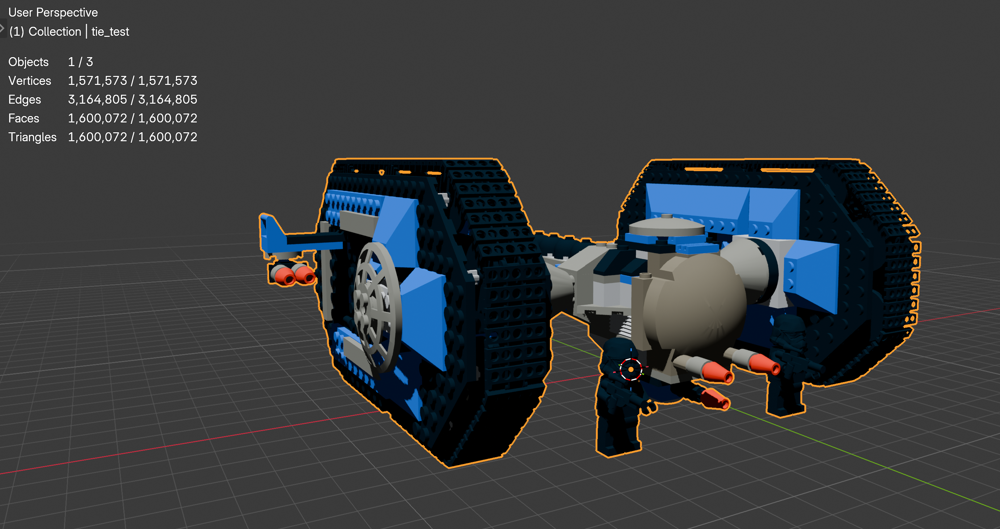
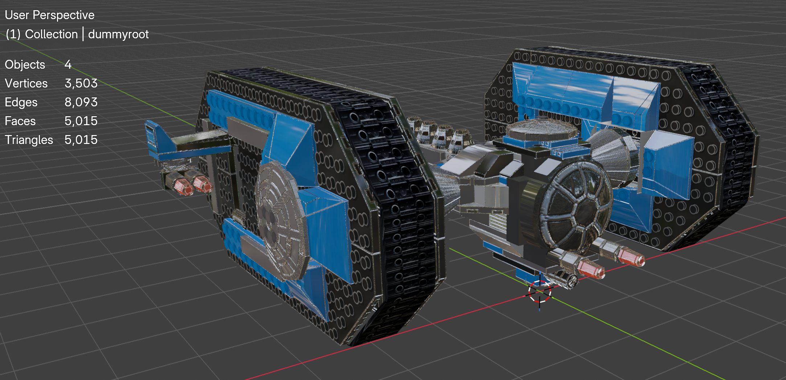
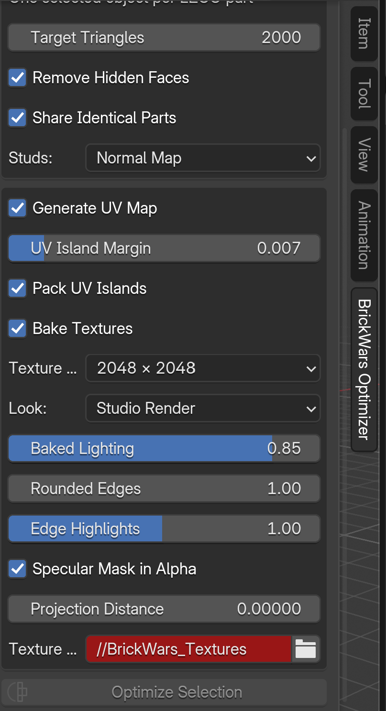

# Blender LOD BrickModel Generator

Blender add-on (BrickWars LEGO Optimizer) that automatically rebuilds imported LEGO models (e.g. from LDD or BrickLink Studio) as low-poly/LOD versions. The details of the original are baked into textures on the new model. It is mainly intended for game modding, such as Star Wars Battlefront II (2005).

## Before / After

**Original:** 1,600,072 triangles

**Result:** 5,015 triangles with baked textures

## Features

- Rebuilds the selected models from a few simple shapes, either from individual parts or from a single merged mesh.
- The maximum number of triangles is adjustable and is respected.
- Diffuse and normal maps are baked from the high-poly model into a shared texture atlas.
- Studs can be transferred as a normal map, removed, or displayed as sprites.
- Identical parts share one texture area, which makes the texture sharper.
- Hidden faces and parts are removed.
- Your own low-poly meshes can also be baked with textures from the original.

The original model stays unchanged. The result is created as `NAME_LOWPOLY` in its own collection.

## Installation

Requires **Blender 5.2** or newer.

1. Download `BrickWars_LEGO_Optimizer-2.7.0.zip`.
2. In Blender, open **Edit → Preferences → Get Extensions → ⋯ → Install from Disk** and select the ZIP file.
3. In the 3D viewport, press **N** to open the sidebar and select the **BrickWars Optimizer** tab.

## Usage

1. Select the model in Object Mode.
2. Set the triangle budget and options.
3. Click **Optimize Selection**.

## License

GPL-3.0-or-later, see [LICENSE](LICENSE).
